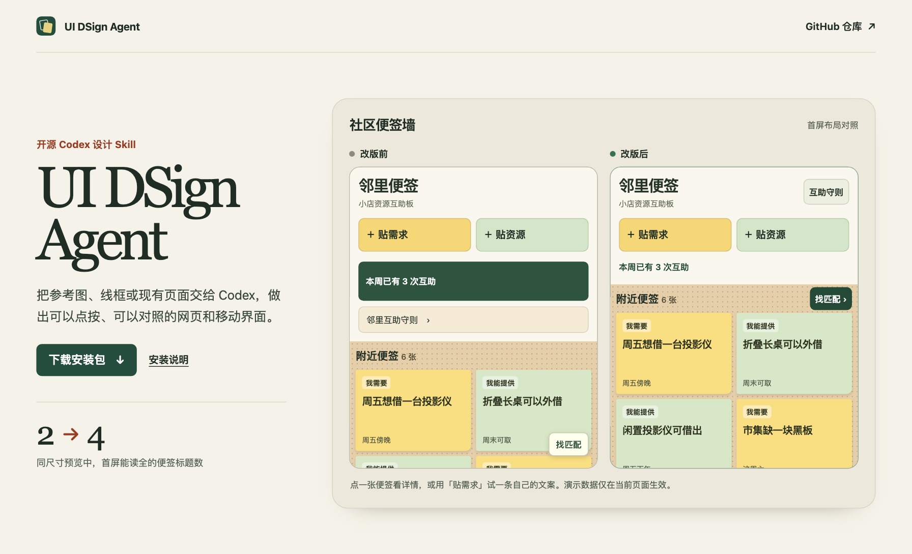

# UI DSign Agent

**一个给 Codex 用的开源 UI 设计 Skill。** 给它一张参考图、一组线框，或直接打开已有项目，告诉它用户最想完成什么。它会沿用项目的组件和视觉风格，把需求落实到页面、交互和可以检查的结果上。

[点开交互演示](https://w88856678-rgb.github.io/ui-dsign-agent/) · [下载安装包](https://github.com/w88856678-rgb/ui-dsign-agent/releases/latest/download/ui-dsign-agent.zip) · [查看首发说明](https://github.com/w88856678-rgb/ui-dsign-agent/releases/tag/v1.0.0)

[](https://w88856678-rgb.github.io/ui-dsign-agent/)

## 看一次改版

一家街坊小店打开社区便签墙，想先看看附近谁在求助。原版把两块公告放在便签前面，匹配提示又浮在卡片上。给 Codex 的任务可以具体到这一句。

> `$ui-dsign-agent` 帮我改这个便签墙首页。保留黄绿便签，让店主打开就能多读几条附近需求，匹配入口也要能用键盘操作。

改版把互助守则移到页头，统计收成一行，匹配入口移到「附近便签」旁。两版使用相同的六条示例内容和 424 CSS 像素高的预览视口。**第一张便签上移了 80 像素，首屏能读全的标题从 2 个变成 4 个。** 打开演示可以点便签、用键盘进入匹配，或贴一条自己的需求，在两版同时查看。[试用便签墙](https://w88856678-rgb.github.io/ui-dsign-agent/)

## 什么时候用它

| 你手里有什么 | 可以交给它的任务 |
| --- | --- |
| 一张参考图，或几张各有优点的截图 | 说清哪张决定布局、哪张提供配色，再把目标页面做成可交互的实现。 |
| 一组 App 线框 | 先统一字级、间距、导航和按钮状态，再验证首页、详情页和表单连起来能否完成任务。 |
| 已经在跑的网页或移动端项目 | 改一个具体问题，例如首屏内容太少、重要入口被遮挡，或表单的失败状态不清楚。 |
| 要放进界面的图标、插画或运营主视觉 | 把构图、材质、光线和文字留白写成素材提示词，同一组素材共享视觉规则。 |

## 安装

在 Codex 里发送下面这条消息。装好后，下一条消息就可以用 `$ui-dsign-agent` 指定它。

```text
$skill-installer 请从 https://github.com/w88856678-rgb/ui-dsign-agent/tree/main/skills/ui-dsign-agent 安装 UI DSign Agent 到我的个人技能目录。
```

也可以下载 ZIP，解压后把整个 `ui-dsign-agent` 文件夹放进个人 Codex 技能目录。压缩包内的 `安装说明.txt` 写有 macOS、Windows 和 Linux 的默认路径。[下载可转发的 ZIP](https://github.com/w88856678-rgb/ui-dsign-agent/releases/latest/download/ui-dsign-agent.zip)

**第一次用**，可以直接在自己的项目里试这句。

```text
$ui-dsign-agent 帮我改这个预约首页。让第一次来的用户一眼找到下一个可预约时间，沿用项目现有组件，给我一个可点击的预览。
```

核心工作流和视觉提示词参考可以独立使用。已安装的 `mobile-app-design`、`better-icons`、`impeccable` 等专长会按任务选用，完整分工表在 Skill 正文中。[工作流源码](skills/ui-dsign-agent/SKILL.md) · [视觉提示词参考](skills/ui-dsign-agent/references/visual-prompts.md)

## 参与改进

欢迎带一个真实页面问题来开 Issue。写下用户原本要完成的任务、现在卡在哪里，以及你希望怎样验收。一张可以公开的截图就能帮大家复现。[提交案例或建议](https://github.com/w88856678-rgb/ui-dsign-agent/issues)

本地打开 `docs/index.html` 就可以离线运行演示。在仓库根目录运行 `python3 scripts/package_release.py`，会在 `dist/` 生成可转发的 ZIP 和离线演示文件。

设计方法参考了《AI 生图提示词 / 生成技巧》的 UI 与运营视觉案例。便签墙演示使用为公开发布编写的示例数据。本仓库的工作流、说明和演示采用 MIT 许可证，提到的第三方 Skill 遵循各自项目的许可。[MIT License](LICENSE)
